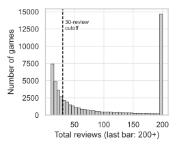
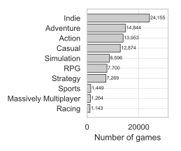
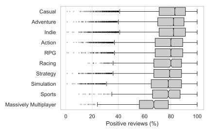
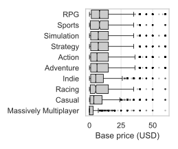
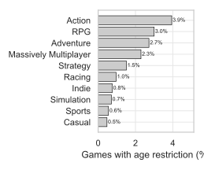
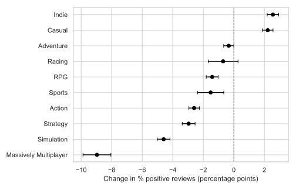

Phase 1 group members: Joanna Calizo (300666927) and Derick Uriel (300663866)

## Content Overview

\hypersetup{linkcolor=black}

| **Section** | **Page** |
|:-----------------------------------|:----------------------------------:|
| \hyperref[sec-exec]{\textbf{Executive Summary}} | \pageref{sec-exec} |
| \hyperref[sec-background]{1. \textbf{Background}} | \pageref{sec-background} |
| \hyperref[sec-data]{2. \textbf{Data Description}} | \pageref{sec-data} |
| \hyperref[sec-data-structure]{\quad a. Data Types and Structure} | \pageref{sec-data-structure} |
| \hyperref[sec-data-vars]{\quad b. Variables Used in the Analysis} | \pageref{sec-data-vars} |
| \hyperref[sec-data-quality]{\quad c. Data Cleaning and Completeness} | \pageref{sec-data-quality} |
| \hyperref[sec-ethics]{3. \textbf{Ethics, Privacy and Security}} | \pageref{sec-ethics} |
| \hyperref[sec-eda]{4. \textbf{Exploratory Data Analysis}} | \pageref{sec-eda} |
| \hyperref[sec-eda-scope]{\quad a. Scoping Data} | \pageref{sec-eda-scope} |
| \hyperref[sec-eda-genre]{\quad b. Genre Distribution} | \pageref{sec-eda-genre} |
| \hyperref[sec-eda-pos]{\quad c. Positive Reviews Distribution} | \pageref{sec-eda-pos} |
| \hyperref[sec-eda-conf]{\quad d. Confounders (Price and Age by Genre)} | \pageref{sec-eda-conf} |
| \hyperref[sec-analysis]{5. \textbf{Detailed Analysis}} | \pageref{sec-analysis} |
| \hyperref[sec-method]{\quad a. Method} | \pageref{sec-method} |
| \hyperref[sec-test]{\quad b. Hypothesis test} | \pageref{sec-test} |
| \hyperref[sec-effects]{\quad c. Size of Each Effect} | \pageref{sec-effects} |
| \hyperref[sec-fit]{\quad d. Model Fit and Prediction} | \pageref{sec-fit} |
| \hyperref[sec-bias]{\quad e. Possible Biases} | \pageref{sec-bias} |
| \hyperref[sec-conclusions]{6. \textbf{Conclusions and Recommendations}} | \pageref{sec-conclusions} |
| \hyperref[sec-references]{7. \textbf{References}} | \pageref{sec-references} |
| \hyperref[sec-appendix-a]{8. \textbf{Appendix A (Robustness Check)}} | \pageref{sec-appendix-a} |
| \hyperref[sec-appendix-b]{9. \textbf{Appendix B (Github Repository)}} | \pageref{sec-appendix-b} |

\hypersetup{linkcolor=blue}

\newpage

## Executive Summary {#sec-exec}

**Goal.** Some genres on Steam seem to get better reviews than others. But genres also differ in price and age rating, which could explain the gap instead. This report asks whether genre is still linked to the share of positive reviews once price and age rating are taken into account. **Data.** I used the Steam Games Dataset from Kaggle (March 2025). It covers 89,618 games. Steam hides review scores for games with fewer than 10 reviews (41% of games). I kept games with at least 30 reviews so each score is stable. This left 34,414 games across 10 main genres. A game can have several genres. No values were missing in the variables I used. **Method.** I fitted a regression model that estimates how much each genre raises or lowers a game's share of positive reviews, with price and age rating held fixed. I tested it by fitting on 80% of games and predicting the other 20%. **Findings.** Genre is clearly linked to review share, even after allowing for price and age rating (p \< 0.001). The table shows the change in percentage points compared with similar games without that genre. The average game has 78.2% positive reviews.

| Genre                 | Change | 95% confidence interval |
|:----------------------|-------:|:-----------------------:|
| Indie                 |   +2.6 |      +2.2 to +2.9       |
| Casual                |   +2.2 |      +1.9 to +2.6       |
| Adventure             |   −0.3 |       −0.7 to 0.0       |
| Racing                |   −0.7 |      −1.7 to +0.3       |
| RPG                   |   −1.4 |      −1.8 to −1.0       |
| Sports                |   −1.5 |      −2.4 to −0.7       |
| Action                |   −2.6 |      −2.9 to −2.3       |
| Strategy              |   −3.0 |      −3.4 to −2.5       |
| Simulation            |   −4.6 |      −5.0 to −4.2       |
| Massively Multiplayer |   −9.0 |      −9.9 to −8.1       |

Massively Multiplayer games had about 9 points fewer positive reviews. For Adventure and Racing there is not enough evidence of a difference. Age-restricted games had 1.3 points fewer positive reviews (95% CI 0.3 to 2.4). Of the prices I checked, games at \$0.99 had the lowest predicted share at 75.4%. Above that, pricier games were reviewed more positively, rising to 82.1% at \$59.99. **Caution.** Genre, price and age rating together explain only about 6% of the variation between games. On new games the model's typical error was about 12 points. Most of what makes a game well reviewed is not in this dataset. These results show links, not causes.

\newpage

## 1. Background {#sec-background}

Steam is the largest digital store for PC games. It is run by Valve and lists tens of thousands of games. Players who own a game can leave a review. Each review is a simple thumbs up (positive) or thumbs down (negative). Steam shows the share of positive reviews on every store page. Buyers use this score to decide what to buy. Developers use it to judge how a game was received. Each game on Steam has one or more genres, such as Action or Strategy. Developers choose these when they list a game. Genres are different from tags, which players can add freely. Massively Multiplayer games are online games where many players share one world. Indie games are made by small independent studios. Free to play games cost nothing to download and earn money through in-game purchases. Early Access games are still being built but can already be bought. An age rating is the minimum age Steam asks players to confirm before viewing a game. In the Phase 1 group report, my group found that the median share of positive reviews differs by genre. Casual games had the highest median at 83%. Massively Multiplayer games had the lowest at 67%. We also found that price and age rating vary by genre ([Section 4d](#sec-eda-conf)). This means the genre gap could partly be a price or age effect. A fair comparison needs to account for both. **Aim.** This report answers one question. What is the relationship between a game's genre and its proportion of positive reviews, after accounting for price and age rating? To answer it, I test whether genre adds explanatory power beyond price and age rating, estimate the size of each genre's effect with confidence intervals, and check how well the model predicts games it has not seen.

## 2. Data Description {#sec-data}

### **2a. Data Types and Structure** {#sec-data-structure}

I used the cleaned March 2025 version of the Steam Games Dataset (Ermilov, 2025). It was collected from the Steam store and the Steam API. It has 89,618 rows and 47 variables. Each row is one game, and games run from 1997 to March 2025. The data is a single snapshot, not a time series. The variables are a mix of numeric (price, review counts, playtime), categorical (developer, publisher, platforms), list (genres, tags) and text (descriptions) types. List variables can hold several values for one game.

\newpage

### **2b. Variables Used in the Analysis** {#sec-data-vars}

| **Variable** | **Type** | **Meaning** |
|:-----------------------|:-----------------------|:-----------------------|
| `pct_pos_total` | Numeric (0 to 100) | Percentage of all user reviews that are positive. Response variable. |
| `num_reviews_total` | Count | Total number of user reviews. Used for filtering. |
| `genres` | List of categories | Steam genres assigned to the game. A game can have several. |
| `price` | Numeric (USD) | Base price at time of scraping. 0 means free. |
| `required_age` | Numeric | Minimum age rating set on Steam. 0 means no restriction. |

The genres list contains 27 labels. Six of them describe content or business model rather than genre: Violent, Gore, Nudity, Sexual Content, Free To Play and Early Access. I removed these. Of the rest, 10 genres have at least 100 games: Action, Adventure, Casual, Indie, Massively Multiplayer, Racing, RPG, Simulation, Sports and Strategy. The others are software labels such as Utilities, with fewer than 10 games each.

### **2c. Data Cleaning and Completeness** {#sec-data-quality}

The dataset has no duplicate games. I dropped columns that hold links, images, videos or long text, since they do not help answer my question. I also dropped score_rank, which is missing for 89,579 games (over 99%). The main data quality issue is in the review variables. Steam sets num_reviews_total and pct_pos_total to −1 when a game has fewer than 10 reviews. This affects 36,419 games (41%). I kept only games with at least 30 reviews. At 10 reviews a single review moves the score by 10 points, but at 30 reviews it moves it by about 3 points. This kept 34,583 games (38.6%). My results therefore describe established games. After removing the six non-genre labels, 167 games had no genre left and two only had software labels. I removed these 169 games, leaving 34,414 for analysis. Price and age rating have no missing values in this sample. The positive and negative columns do not add up to num_reviews_total for 93% of games, as they appear to come from different parts of the Steam API. I therefore used pct_pos_total as the response. I also found that Steam stores each game's genres in alphabetical order (99.7% of games). This means the first genre listed is not a "main" genre. I kept every genre a game has instead of choosing one.

## 3. Ethics, Privacy and Security {#sec-ethics}

**Data and privacy.** The data was scraped from the public Steam store and the Steam API. The variables I used hold no reviewer names, account IDs or review text, so no personal data was used. Review text can contain personal details, but I did not use it. Game titles and descriptions are copyrighted, so I used them only for analysis and do not republish them. **Bias in reviews.** Review share reflects the players who chose to leave a review, not all players. People with strong opinions are more likely to review. Some games are also hit by "review bombing", where many negative reviews are posted in a short time over an issue outside the game itself. Online games with ongoing updates and in-game purchases may be more exposed to this. This could lower Massively Multiplayer scores for reasons that are not about game quality. My 30-review filter also removes most small games, so results may not apply to new or niche titles. **Fair use of results.** Ranking genres as "better" or "worse" could unfairly steer buyers and developers away from some genres. My model shows associations, not causes, and genre explains only a small part of review share. I state these limits wherever results are reported. **Security.** Below I separate the steps I took from the steps I would take with more time and resources.

*Steps taken:* code is stored in a public GitHub repository so it can be checked. The raw data file is kept out of the repository through .gitignore. Group files from Phase 1 were shared only with group members and the supervisor. This report was written in Quarto and rendered to PDF. *Steps I would take:* turn on two-factor login for all accounts with access, store the data on an encrypted drive, keep an access log, and delete local copies of the data when the project ends.

## 4. Exploratory Data Analysis {#sec-eda}

This section revises the Phase 1 exploratory analysis. I kept only the plots that relate to my question. All plots use the 34,414 games described in [Section 2c](#sec-data-quality), except [Figure 1](#fig-reviews).

#### **4a. Scoping Data** {#sec-eda-scope}

[Figure 1](#fig-reviews) shows how many reviews each game has. Most games sit at the low end. The dashed line marks my 30-review cutoff. Below this line a few reviews can swing a game's score a lot.

{#fig-reviews fig-align="center" width="50%" fig-pos="H"}

#### **4b. Genre Distribution** {#sec-eda-genre}

[Figure 2](#fig-genres) shows how many games carry each of the 10 genres, with exact counts on each bar. Indie is by far the most common with 24,155 games, followed by Adventure (14,844) and Action (13,953). The smallest genre is Racing with 1,143 games. A game with several genres is counted once in each, so the bars add up to more than 34,414.

{#fig-genres fig-align="center" width="50%" fig-pos="H"}

#### **4c. Positive Reviews Distribution** {#sec-eda-pos}

[Figure 3](#fig-pospct) shows the share of positive reviews by genre. Genres are sorted by median. All boxes use one colour, which carries no meaning. The notches show approximate 95% confidence intervals for each median, calculated as the median ± 1.57 × IQR / $\sqrt{n}$ (McGill et al., 1978). These intervals are symmetric by construction. If two notches do not overlap, there is good evidence that the medians differ. Casual has the highest median at 83%. Adventure and Indie follow at 82% and their notches overlap. Action, RPG and Racing all sit at 80% and overlap each other. Racing also overlaps Strategy (79%). Strategy overlaps Sports, and Sports overlaps Simulation (both 78%). Massively Multiplayer has a median of 67% and overlaps no other genre. Every genre has a long tail of games with low scores.

{#fig-pospct fig-align="center" width="70%"}

#### **4d. Confounders (Price and Age by Genre)** {#sec-eda-conf}

`price` is the base price in US dollars. [Figure 4](#fig-price) shows price by genre for games under \$60. Sports and RPG have the highest median at \$7.99 and their notches overlap. Simulation and Strategy overlap at \$6.99. Adventure and Action overlap at \$5.99. Indie and Racing overlap at \$4.99. Casual is lower at \$3.49. Massively Multiplayer has a median of \$0, because 69% of these games are free to play. Only 47 games (0.14%) cost \$60 or more, with a maximum of \$199.99. They were left out of the plot for readability but kept in the model. Their median positive share is 70%, compared with 82% for games under \$60. `required_age` is the minimum age rating. [Figure 5](#fig-age) shows the share of games in each genre with any age restriction. Action has the highest share at 3.9% and Casual the lowest at 0.5%.

{#fig-price fig-align="center" width="55%" fig-pos="H"}

{#fig-age fig-align="center" width="55%" fig-pos="H"}

Casual has the lowest age restriction share and the highest review share. Action and RPG have high age restriction shares and lower review shares. Price and age rating clearly vary across genres. These plots cannot show whether genre still matters once both are held fixed. This is why I fit a model in the next section.

## 5. Detailed Analysis {#sec-analysis}

#### **5a. Method** {#sec-method}

**Model choice.** The response is the share of positive reviews, a proportion between 0 and 1. Each review is a positive or negative vote, so logistic regression for yes/no outcomes is a natural fit. I used **fractional logistic regression** (Papke & Wooldridge, 1996). This is a binomial generalised linear model (GLM) with a logit link, fitted to the proportion of positive reviews. It has three benefits. Predictions always stay between 0% and 100%. The 396 games with exactly 0% or 100% positive reviews can be kept without adjustment. And it does not assume the response is normally distributed.

**Model terms.** The model is

$$\log\left(\frac{p_i}{1-p_i}\right) = \beta_0 + \beta_1 \log(1 + \text{price}_i) + \beta_2\, \text{free}_i + \beta_3\, \text{age}_i + \sum_{k=1}^{10} \gamma_k\, \text{genre}_{ik}$$

where $p_i$ is the share of positive reviews for game $i$. The terms are:

- $\log(1 + \text{price})$: price is strongly right-skewed. The log reduces the pull of a few very expensive games. Adding 1 allows free games to be included.
- **free**: 1 if the game costs \$0, otherwise 0. Free games may behave differently from cheap paid games.
- **age**: 1 if `required_age` is above 0, otherwise 0. Most age values had very few games, so a single indicator is more stable.
- **genre**: one 0/1 indicator for each of the 10 genres. A game tagged Action and Indie has a 1 in both. Each game appears once, so no game is counted twice.

There are no interaction terms. I used robust (HC1) standard errors, which give valid confidence intervals even if the spread of the response differs between games. **Why not one genre per game.** An earlier version used the first listed genre as a game's main genre. Because genre lists are alphabetical ([Section 2c](#sec-data-quality)), this gave Action to every Action game and rarely gave Strategy. The indicator approach avoids this and uses all genre information. **Missing data.** No model variable has missing values after filtering. The main exclusion is the review filter, which is not random ([Section 2c](#sec-data-quality)).

\newpage

#### **5b. Does Genre Matter After Price and Age?** {#sec-test}

I compared a model with only price and age terms against the full model with genre added. The null hypothesis is that all 10 genre coefficients are zero. In other words, genre adds nothing once price and age are known. A Wald test rejects this hypothesis ($\chi^2$ = 2140.6, df = 10, p \< 0.001). There is strong evidence that genre is linked to review share after accounting for price and age rating. [Table 1](#tbl-compare) shows the share of deviance explained, which plays the role of $R^2$ for a GLM. Price and age alone explain 0.5%. Adding genre raises this to 6.1%. Genre adds far more than price and age, but most of the variation between games remains unexplained.

| **Model** | **Terms** | **Deviance explained** |
|:---|:---|---:|
| Price and age only | log price, free, age restricted | 0.005 |
| Price, age and genre | Adds 10 genre indicators | 0.061 |

: Comparison of nested models fitted to 34,414 games

#### **5c. Size of Each Effect** {#sec-effects}

Log-odds coefficients are hard to read, so I converted them into **average marginal effects** in percentage points. For each genre, I predicted every game's review share with that genre switched on and then switched off. The average difference is the effect. 95% confidence intervals were found with the delta method. The coefficients themselves are in [Table 5](#tbl-robust).

| **Term**              | **Games** | **Effect (pp)** |   **95% CI**   | **p-value** |
|:----------------|-------------:|-------------:|:------------:|-------------:|
| Indie                 |    24,155 |            2.56 |  (2.18, 2.93)  |     \<0.001 |
| Casual                |    12,874 |            2.22 |  (1.87, 2.57)  |     \<0.001 |
| Adventure             |    14,844 |           −0.33 | (−0.67, 0.00)  |       0.051 |
| Racing                |     1,143 |           −0.70 | (−1.68, 0.28)  |       0.154 |
| RPG                   |     7,700 |           −1.42 | (−1.81, −1.03) |     \<0.001 |
| Sports                |     1,449 |           −1.52 | (−2.38, −0.66) |     \<0.001 |
| Action                |    13,953 |           −2.60 | (−2.95, −2.26) |     \<0.001 |
| Strategy              |     7,269 |           −2.96 | (−3.38, −2.54) |     \<0.001 |
| Simulation            |     8,596 |           −4.60 | (−5.01, −4.18) |     \<0.001 |
| Massively Multiplayer |     1,264 |           −8.97 | (−9.88, −8.05) |     \<0.001 |
| Age restricted        |       803 |           −1.33 | (−2.40, −0.26) |       0.013 |

: Average marginal effects on the percentage of positive reviews, in percentage points (pp). Each effect compares games with and without that feature, holding all other terms fixed. The mean positive share in the sample is 78.2%

{#fig-effects fig-align="center" width="75%"}

[Table 2](#tbl-effects) and [Figure 6](#fig-effects) show the results. Indie (+2.6) and Casual (+2.2) are linked to more positive reviews. Six genres are linked to fewer. Massively Multiplayer is the clear outlier at −9.0 points, almost twice the next largest effect. For Adventure (p = 0.051) and Racing (p = 0.154) there is not enough evidence of an effect. This does not mean they have no effect. Age-restricted games have 1.3 fewer points (p = 0.013). The ordering is close to the medians in [Figure 3](#fig-pospct). Casual and Indie stay near the top and Massively Multiplayer stays at the bottom. So the genre gaps seen in the EDA are not explained by price or age rating. [Table 3](#tbl-price) shows how predicted review share changes with price, with all other terms kept as observed. The relationship is not a straight line. Of the prices shown, games at \$0.99 have the lowest predicted share. Free games sit 1.9 points above them (95% CI 1.3 to 2.4). Above \$0.99, review share rises steadily with price. One reason may be that more expensive games tend to come from larger studios with bigger budgets.

\newpage

| **Price (USD)** | **Predicted % positive** |  **95% CI**  |
|----------------:|-------------------------:|:------------:|
|            0.00 |                     77.2 | (76.9, 77.6) |
|            0.99 |                     75.4 | (74.9, 75.8) |
|            4.99 |                     77.7 | (77.5, 77.9) |
|            9.99 |                     78.9 | (78.7, 79.1) |
|           19.99 |                     80.1 | (79.9, 80.4) |
|           59.99 |                     82.1 | (81.7, 82.5) |

: Average predicted percentage of positive reviews if every game had the given price, with genre and age rating as observed

#### **5d. Model Fit and Prediction** {#sec-fit}

To test prediction, I randomly split the games 80/20. I fitted each model on 27,531 games and predicted the other 6,883. [Table 4](#tbl-perf) shows the root mean squared error (RMSE) and mean absolute error (MAE) in percentage points. A model that predicts the average for every game is included as a baseline.

| **Model**            | **Test RMSE (pp)** | **Test MAE (pp)** |
|:---------------------|-------------------:|------------------:|
| Mean only            |              15.54 |             12.34 |
| Price and age        |              15.49 |             12.30 |
| Price, age and genre |              15.00 |             11.85 |

: Prediction error on a held-out 20% test set (6,883 games). Models were fitted on the other 80%

Price and age barely improve on the baseline. Adding genre lowers the error by about half a point, but the typical error is still about 12 points. The model describes differences between groups of games well, but it cannot predict an individual game's score with much accuracy. [Figure 7](#fig-resid) in [Appendix A](#sec-appendix-a) shows the model residuals. For 98% of games the fitted values sit in a narrow band from 64% to 84%, while real scores range from 0% to 100%. This matches the low deviance explained. The residuals are skewed to the left, because some games score far below what their genre and price suggest. There is no strong curve in the residuals. Variance inflation factors were all below 3, so the predictors are not highly correlated with each other. **Robustness.** I refitted the model with ordinary least squares on an empirical logit, $\log\left((k + 0.5)/(n - k + 0.5)\right)$, where $k$ is the number of positive reviews and $n$ the total. Every term kept the same sign and a similar size ([Table 5](#tbl-robust)). The conclusions do not depend on the choice of model.

#### **5e. Possible Biases** {#sec-bias}

- **Survivorship and self-selection.** Only games with at least 30 reviews are included, and reviewers are not a random sample of players ([Section 3](#sec-ethics)).
- **Genre labels.** Developers choose their own genres. Some may add popular genres to attract buyers.
- **Price snapshot.** Price is the base price at the time of scraping. Sales and past price changes are not captured.
- **Large sample.** With 34,414 games even very small effects become statistically significant. This is why I focus on effect sizes and intervals, not only p-values.

## 6. Conclusions and Recommendations {#sec-conclusions}

**Conclusions.** Genre is linked to the share of positive reviews on Steam, even after accounting for price and age rating (p \< 0.001). Indie and Casual games are reviewed slightly more positively. Massively Multiplayer games are reviewed about 9 points less positively than similar games. Simulation, Strategy and Action games also score lower. The effects are clear but small. Genre, price and age rating together explain only about 6% of the variation in review share.

**Recommendations.**

- **Buyers** should compare a game's score with others in the same genre. A score of 67% is the median for a Massively Multiplayer game, but it would be low for a Casual game, where the median is 83%.
- **Developers** of Massively Multiplayer and Simulation games should expect lower baseline scores. They should judge their reception against genre peers, not the whole store.
- **Steam** could show genre averages next to review scores to give buyers this context.

**Limitations.** These results show associations, not causes. Genre may stand in for things the data does not hold, such as studio size, game length or how often a game is updated. The results describe established games at a single point in time. **Future work.** The model could add release year or test interactions such as genre × price. Repeating it on the May 2024 dataset would check whether the results replicate. 5-fold cross-validation would give a more stable estimate of prediction error.

**AI use.** I used Claude (Anthropic) to check my code and numbers, fix the formatting and help edit the wording. All analysis decisions are my own.

\newpage

## 7. References {#sec-references}

Ermilov, A. (2025). Steam games dataset.

- Kaggle. <https://www.kaggle.com/datasets/artermiloff/steam-games-dataset>

McGill, R., Tukey, J. W., & Larsen, W. A. (1978). Variations of box plots.

- The American Statistician, 32(1), 12–16. <https://doi.org/10.2307/2683468>

Papke, L. E., & Wooldridge, J. M. (1996). Econometric methods for fractional response variables with an application to 401(k) plan participation rates.

- Journal of Applied Econometrics, 11(6), 619–632.

\newpage

## 8. Appendix A (Robustness Check) {#sec-appendix-a}

| **Term**              | **Fractional logit** | **OLS empirical logit** |
|:----------------------|---------------------:|------------------------:|
| Intercept             |                1.109 |                   1.361 |
| log(1 + price)        |                0.119 |                   0.126 |
| Free                  |                0.186 |                   0.199 |
| Age restricted        |               −0.077 |                  −0.114 |
| Indie                 |                0.149 |                   0.166 |
| Adventure             |               −0.020 |                  −0.030 |
| Action                |               −0.153 |                  −0.191 |
| Casual                |                0.133 |                   0.149 |
| Simulation            |               −0.263 |                  −0.295 |
| RPG                   |               −0.083 |                  −0.112 |
| Strategy              |               −0.171 |                  −0.233 |
| Sports                |               −0.088 |                  −0.131 |
| Massively Multiplayer |               −0.474 |                  −0.589 |
| Racing                |               −0.041 |                  −0.047 |

: Coefficients on the log-odds scale from the main model and the OLS robustness check. Both use robust standard errors

{#fig-resid fig-align="center" width="85%"}

## 9. Appendix B (Github Repository) {#sec-appendix-b}

<https://github.com/rakeikahukoti-del/DATA301-individual-project>
